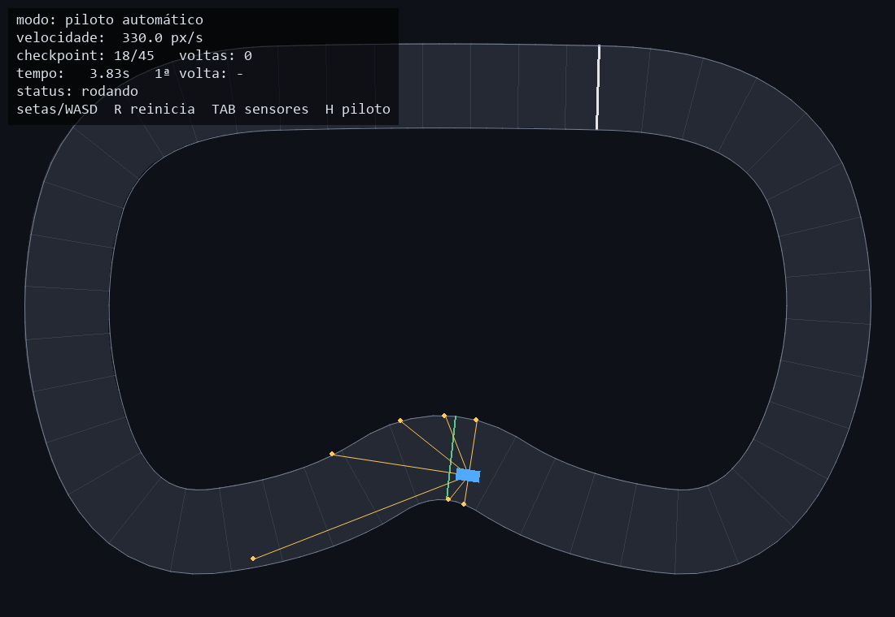

# Carrinhos que Aprendem a Dirigir 🏎️🧬

Uma população de carros aprende a completar uma pista usando **neuroevolução**:
cada carro é controlado por uma pequena rede neural, e as redes evoluem por
seleção, cruzamento e mutação ao longo das gerações (sem backpropagation, sem dataset).

> **Status:** Fase 1 concluída (simulação base). Próximo passo: rede neural + algoritmo genético.



*Carro (azul) com 7 sensores de distância (amarelo), próximo checkpoint (verde) e linha de largada (branca).*

## Rodando

```bash
py -3.12 -m venv .venv          # Windows (Linux/macOS: python3 -m venv .venv)
.venv\Scripts\activate          # Linux/macOS: source .venv/bin/activate
pip install -e ".[dev]"

python scripts/play_manual.py --track configs/tracks/simple.yaml   # dirigir pelo teclado
python scripts/play_manual.py --autopilot                          # ver a heurística dirigir
pytest -q
ruff check . && mypy carros scripts
```

Controles do modo manual: **setas/WASD** dirigem, **R** reinicia, **TAB** liga/desliga
os sensores, **H** liga/desliga o piloto automático, **ESC** sai. Por padrão o modo manual
só elimina por colisão; `--strict` liga também as regras "ficou parado" e "sem checkpoint".

## Arquitetura

```
carros/
  sim/            # simulação pura (NumPy) — nunca importa Pygame
    geometry.py   #   raycast e interseção de segmentos, vetorizados
    spatial.py    #   grade espacial de paredes (broad phase)
    track.py      #   pista: linha central -> bordas, paredes, checkpoints
    car.py        #   modelo cinemático do carro (N carros de uma vez)
    sensors.py    #   raios de distância normalizados em [0, 1]
    world.py      #   mundo: colisão, checkpoints, voltas, eliminação
    config.py     #   leitura do YAML de física
  render/view.py  # desenho com Pygame (pista, carros, raios, HUD)
  baselines.py    # políticas de referência: heurística e aleatória
configs/          # YAML: física (sim_default.yaml) e pistas (tracks/)
scripts/          # pontos de entrada (play_manual.py; train/replay/compare nas próximas fases)
tests/
```

A separação **simulação × render** é o que permite treinar sem janela (headless)
e muito mais rápido que tempo real, e depois reproduzir o melhor carro com gráficos.

## Decisões de projeto (e o porquê)

**Simulação vetorizada desde o início.** O estado de `N` carros fica em arrays NumPy
(`x`, `y`, `heading`, `speed`), e física, sensores e colisão operam no lote inteiro de uma vez.
O modo manual usa `N = 1`; a Fase 2 vai usar `N = 100` sem reescrever nada.

**Pista = linha central + largura.** O YAML lista pontos de controle da linha central; ela é
suavizada (algoritmo de Chaikin), reamostrada com espaçamento uniforme e deslocada para os dois
lados para gerar as bordas interna e externa. Isso garante que os checkpoints sejam segmentos
transversais bem distribuídos e facilita o gerador de pistas aleatórias da Fase 3.
Pistas inválidas (curva fechada demais para a largura, fazendo a borda "dobrar") são rejeitadas
na carga com uma mensagem clara.

**Modelo cinemático simples.** Posição, ângulo e velocidade; o acelerador muda a velocidade e o
volante muda o ângulo. O giro é proporcional à velocidade em baixa (carro parado não gira no
lugar), há atrito proporcional à velocidade e a velocidade nunca fica negativa (sem ré).
Não há aleatoriedade: com o mesmo `dt` e os mesmos comandos, o resultado é idêntico (testado).

**Colisão pelo retângulo do carro + segmento varrido.** Cada lado do carro é testado contra as
paredes. Além disso, o segmento entre a posição anterior e a nova também é testado: sem isso,
um carro rápido poderia "pular" uma parede fina entre dois passos (*tunneling*).

**Sensores normalizados.** 7 raios num leque de 180°, distância dividida pelo alcance máximo:
0 = encostado na parede, 1 = livre. Entradas na mesma escala facilitam a vida da rede neural.

**Eliminação.** Um carro sai da rodada se bater, se ficar parado por 2 s ou se passar 6 s sem
alcançar um novo checkpoint. As duas últimas regras cortam carros que "aprenderiam" a não fazer
nada (parados não batem) ou a andar em círculos — e economizam tempo de simulação.

**Grade espacial (broad phase).** Testar cada carro contra todas as 270 paredes era o gargalo.
O mapa é dividido em células de 40 px e cada célula guarda, pré-calculadas, as paredes que podem
interessar (perto, para colisão; dentro do alcance dos raios, para sensores). O resultado é
idêntico ao da força bruta (há teste comparando os dois) e ~3,5x mais rápido.

**Desempenho atual:** 100 carros vivos simulam 10 s de pista em ~1,3 s (≈ 7,5x tempo real, pior
caso, sem render). No treino a maioria dos carros morre cedo nas primeiras gerações, então o
ganho real é maior; se precisar, a Fase 2 pode paralelizar com `multiprocessing`.

**Heurística de referência já na Fase 1.** A política "vire para o lado com mais espaço, freie
quando a frente estiver perto" completa a pista simples (volta de ~8 s). Isso prova que a pista e a
física são dirigíveis *antes* de culpar a evolução se algo não aprender — e vira baseline na
comparação final.

## Testes

36 testes cobrindo: raycast (distância exata, raio paralelo, alcance máximo, parede mais próxima),
interseção de segmentos, grade espacial = força bruta, validação de pista, física do carro,
sensores num corredor com resposta conhecida, colisão (incluindo anti-tunneling), contagem de
checkpoints, eliminação por parada e por falta de progresso, volta completa da heurística e
determinismo.

## Roadmap

- [x] **Fase 1** — pista, carro, sensores, colisão, render e modo manual
- [ ] **Fase 2** — rede neural (MLP em NumPy) + algoritmo genético na pista simples
- [ ] **Fase 3** — pistas difíceis, gerador aleatório e teste de generalização
- [ ] **Fase 4** — replay "geração 1 vs 10 vs 50", GIF/MP4, gráficos
- [ ] **Fase 5** — extras (editor de pista, CMA-ES, obstáculos)
