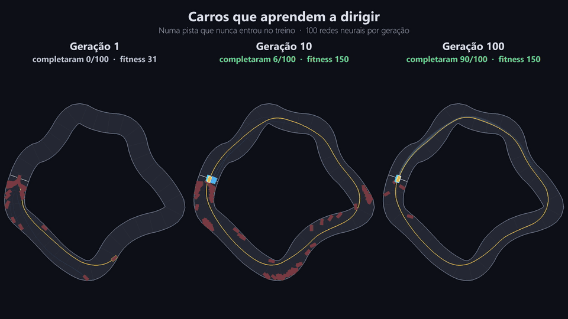
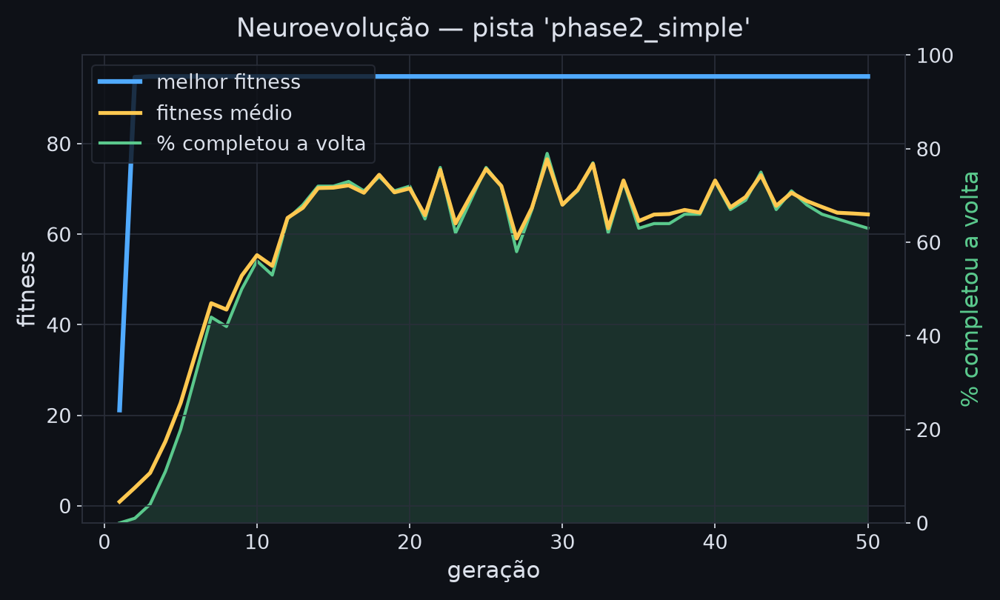
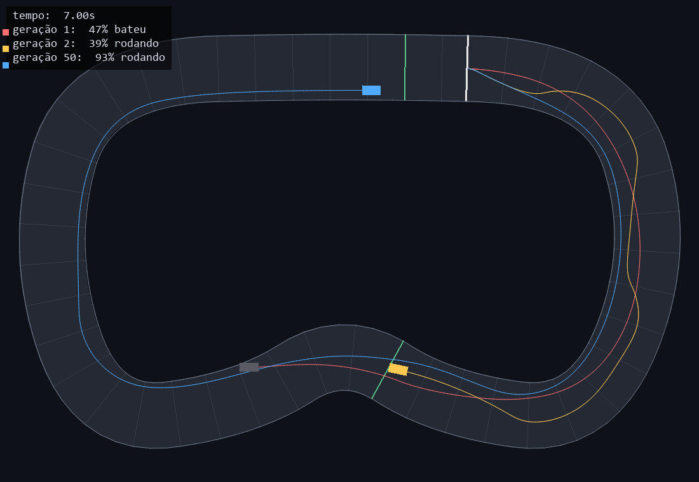
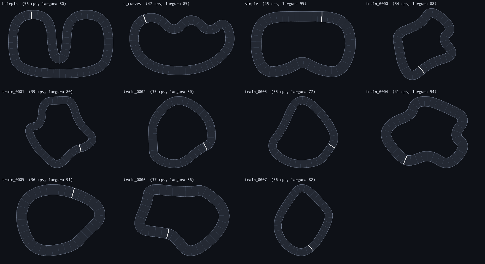
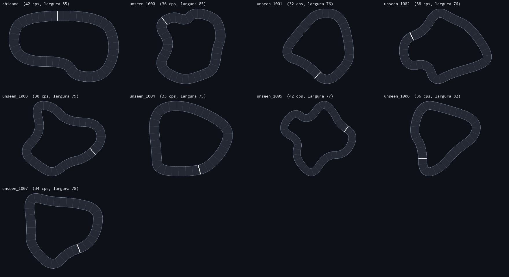
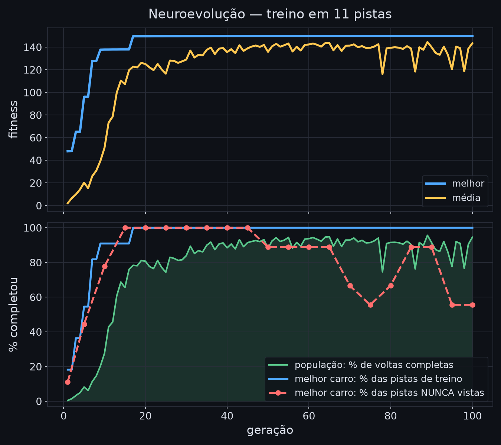
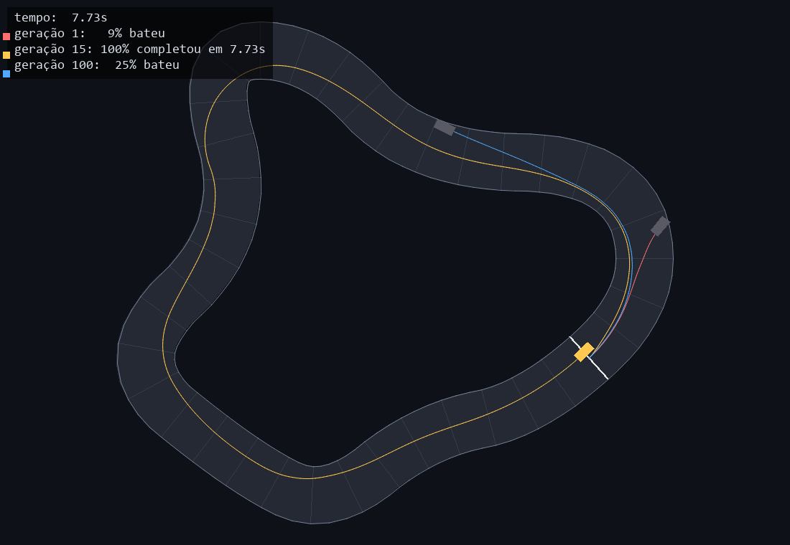
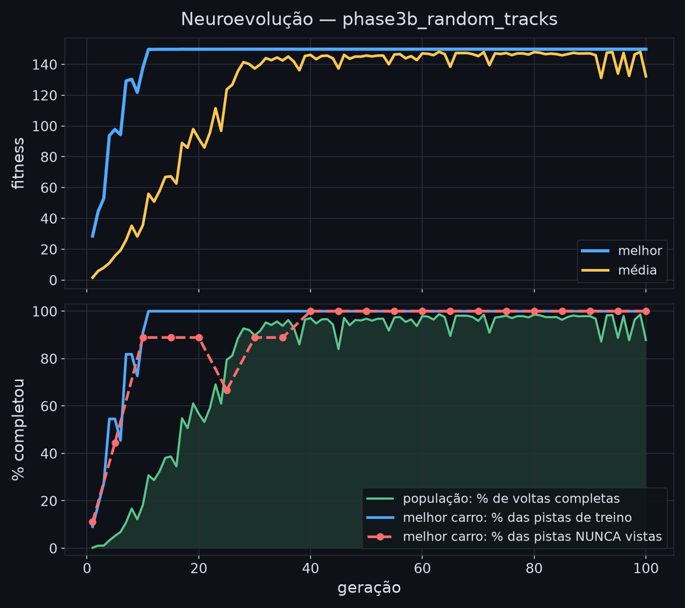

# Carrinhos que Aprendem a Dirigir 🏎️🧬

Uma população de carros aprende a completar uma pista usando **neuroevolução**:
cada carro é controlado por uma pequena rede neural, e as redes evoluem por
seleção, cruzamento e mutação ao longo das gerações (sem backpropagation, sem dataset).

> **Status:** Fases 1 a 3 concluídas, overfitting corrigido e vídeos prontos.



*100 redes neurais por geração, numa pista que **nunca entrou no treino**. Dourado: o melhor carro.
Vermelho: quem bateu. Completam a volta: 0, 6 e 90 de 100. Vídeos em [videos/](videos).*

## Rodando

```bash
py -3.12 -m venv .venv          # Windows (Linux/macOS: python3 -m venv .venv)
.venv\Scripts\activate          # Linux/macOS: source .venv/bin/activate
pip install -e ".[dev]"

python scripts/play_manual.py --track configs/tracks/simple.yaml   # dirigir pelo teclado
python scripts/play_manual.py --autopilot                          # ver a heurística dirigir
python scripts/train.py --config configs/phase2_simple_track.yaml  # treinar (~35 s)
python scripts/replay.py --checkpoint checkpoints/phase2_simple/best_gen050.npy
python scripts/replay.py --checkpoint checkpoints/phase2_simple/best_gen001.npy \
    checkpoints/phase2_simple/best_gen002.npy checkpoints/phase2_simple/best_gen050.npy

python scripts/train.py --config configs/phase3_generalization.yaml  # 11 pistas (~8 min)
python scripts/compare.py --run checkpoints/phase3_generalization --generations 1,15,100 \
    --tracks configs/tracks/unseen configs/tracks/chicane.yaml
python scripts/replay.py --track configs/tracks/unseen/unseen_1003.yaml --checkpoint \
    checkpoints/phase3_generalization/best_gen015.npy checkpoints/phase3_generalization/best_gen100.npy
python scripts/generate_tracks.py --out configs/tracks/unseen --prefix unseen --seeds 1000-1007
python scripts/preview_tracks.py configs/tracks/unseen --out pistas.png
pytest -q
ruff check . && mypy carros scripts
```

Controles do modo manual: **setas/WASD** dirigem, **R** reinicia, **TAB** liga/desliga
os sensores, **H** liga/desliga o piloto automático, **ESC** sai. Por padrão o modo manual
só elimina por colisão; `--strict` liga também as regras "ficou parado" e "sem checkpoint".

## Arquitetura

```
carros/
  sim/            # simulação pura (NumPy) — nunca importa Pygame
    geometry.py   #   raycast e interseção de segmentos, vetorizados
    spatial.py    #   grade espacial de paredes (broad phase)
    track.py      #   pista: linha central -> bordas, paredes, checkpoints
    car.py        #   modelo cinemático do carro (N carros de uma vez)
    sensors.py    #   raios de distância normalizados em [0, 1]
    world.py      #   mundo: colisão, checkpoints, voltas, eliminação
    config.py     #   leitura do YAML de física
    generator.py  #   gerador de pistas aleatórias (por semente)
  brain/mlp.py    # rede neural em NumPy, avaliando a população inteira de uma vez
  evolution/
    fitness.py    #   o que a evolução maximiza
    operators.py  #   torneio, crossover, mutação, medida de diversidade
    ga.py         #   uma geração: elitismo + reprodução + reação à baixa diversidade
    evaluate.py   #   episódios, controladores (rede/baselines), várias pistas em paralelo
    trainer.py    #   laço de treino, validação, histórico CSV, checkpoints
    config.py     #   leitura do YAML do experimento
  render/
    view.py       #   desenho com Pygame (pista, carros, raios, rastros, HUD)
    video.py      #   exportação de MP4
    plots.py      #   gráfico de fitness (Matplotlib)
  baselines.py    # políticas de referência: heurística e aleatória
configs/          # YAML: física, gerador, experimentos e pistas
  tracks/         #   à mão (simple, hairpin, s_curves, chicane), train/, unseen/ e test/ (geradas)
scripts/          # play_manual, train, replay, compare, generate_tracks, preview_tracks
checkpoints/      # saída do treino (ignorada pelo git): config, history.csv, fitness.png, best_genXXX
tests/
```

A separação **simulação × render** é o que permite treinar sem janela (headless)
e muito mais rápido que tempo real, e depois reproduzir o melhor carro com gráficos.

## Fase 2 — Neuroevolução

### Como funciona

1. **100 carros**, cada um com uma rede `8 → 8 → 2` (7 sensores + velocidade → volante e
   acelerador, `tanh` em tudo). Os 90 pesos de cada rede formam o **genoma**: um vetor plano.
2. Todos dirigem ao mesmo tempo, por até 40 s. Ninguém usa gradiente nem dados de exemplo:
   cada rede só é *julgada* pelo resultado (fitness).
3. A próxima geração nasce dos melhores: 5 de **elite** passam intactos; o resto vem de pais
   escolhidos por **torneio** (o melhor de 4 sorteados), **crossover uniforme** (cada gene
   vem de um dos pais) e **mutação gaussiana** (10% dos genes recebem ruído).
4. Repete por 50 gerações, salvando o melhor genoma de **cada** geração.

### Decisões (e o porquê)

**Fitness = 100 × progresso + 50 × completou − 0,02 × segundos vivo.** O *progresso* é a fração
da volta, contínua (checkpoints + fração do caminho até o próximo, sobre o total de checkpoints).
Ser fração deixa pistas de tamanhos diferentes na mesma escala. Mesmo na geração 1, em que todos batem,
"bateu perto do checkpoint" vale mais que "bateu logo" — a seleção tem por onde puxar.
O bônus de volta garante que completar sempre vence. A penalidade de tempo é leve: só desempata
quem completa (o mais rápido ganha) e nunca compensa bater cedo. Velocidade **não** é
recompensada diretamente — isso ensinaria a bater rápido.

**Torneio em vez de roleta.** A roleta depende da escala do fitness (que pode ser negativo); o
torneio só usa a ordem, e o tamanho do torneio controla a pressão seletiva.

**Mutação com decaimento** (σ = 0,4 × 0,97^geração, piso 0,05): passos grandes para explorar no
início, ajuste fino depois.

**Monitor de diversidade.** A cada geração mede-se o desvio padrão médio dos genes. Abaixo de
0,1 (população quase clonada = convergência prematura), a mutação é triplicada e 10% da
população é trocada por indivíduos aleatórios. Nesta pista não chegou a disparar (mínimo 0,20).

**População avaliada em lote.** A rede usa `einsum` com tensores `(carros, entrada, saída)`:
os 100 cérebros rodam numa operação só. Cada geração leva ~0,6 s.

**Reprodutibilidade.** Semente fixa no YAML; o treino salva junto dos checkpoints a config do
experimento e cópias da pista e da física usadas.

### Resultados na pista simples



| geração | melhor carro | % da população que completa | volta mais rápida |
|---:|---|---:|---:|
| 1 | bate a 47% da volta | 0% | — |
| 2 | completa | 1% | 15,77 s |
| 10 | completa | 57% | 7,52 s |
| 50 | completa | 65% | **7,42 s** |
| heurística (referência) | completa | — | 8,07 s |

O que os números dizem:

* **A pista simples é fácil para essa rede:** já na geração 2 um carro completa. A evolução
  passa então a otimizar *tempo de volta* e a *espalhar* a solução pela população.
* **A volta parou em 7,42 s — e isso não é estagnação.** A linha central tem 2410 px; mesmo
  andando a velocidade máxima (330 px/s) desde o instante zero, seriam 7,30 s. O carro sai
  parado, então 7,42 s está praticamente no limite físico (ele ainda ganha cortando curvas).
* **Por que só ~65% da população completa, e não 100%?** Porque 95 dos 100 carros de cada
  geração são filhos *mutados*. Parte das mutações estraga uma rede boa — é o preço da
  exploração. A elite (5 melhores intactos) garante que o melhor nunca piora.
* A evolução **supera a heurística** escrita à mão (7,42 s vs 8,07 s).



## Fase 3 — Pistas difíceis e generalização

**Pergunta:** o carro aprendeu a *dirigir* ou só *decorou a pista*? Para responder, ele treina em
um conjunto de pistas e é testado em outro que **nunca** entra no fitness.

| treino (11 pistas: fitness = média) | validação (9 pistas nunca vistas) |
|---|---|
|  |  |

* **Pistas à mão:** grampo (curva de ~180° num "dedo" estreito), S e chicane. O validador de
  pista rejeitou a primeira versão do S (curvas fechadas demais para a largura).
* **Gerador** (`configs/generator.yaml`): 8–13 pontos em volta de um círculo, com raio e ângulo
  sorteados, suavizados por Chaikin; pistas inválidas são re-sorteadas. O **sentido de corrida
  também é sorteado** — senão a rede poderia aprender só a virar para um lado.
  Treino usa as sementes 0–7; validação, 1000–1007 (há teste garantindo que não se misturam).
* **Validação honesta:** o melhor carro de cada geração é escolhido **só pelo treino** e então
  corre nas pistas novas. Escolher pelo resultado da validação seria "colar na prova".
* **11 pistas em paralelo**, um processo por pista (`ProcessPoolExecutor`): 3–12 s por geração.

### Resultado: aprende a dirigir… e depois começa a decorar



Melhor carro de cada geração nas **9 pistas nunca vistas** (`scripts/compare.py`):

| agente | % média da volta | pistas novas completadas | tempo médio* |
|---|---:|---:|---:|
| geração 1 | 25% | 11% | 6,33 s |
| geração 5 | 66% | 44% | 6,59 s |
| **geração 15** | **100%** | **100%** | 8,56 s |
| geração 50 | 95% | 89% | 6,63 s |
| geração 100 | 73% | 56% | 6,52 s |
| heurística | 100% | 100% | 7,93 s |
| aleatório (média de 20) | 1,5% | 0% | — |

\* só nas pistas completadas. Tabela completa por pista: [docs/fase3_comparacao.md](docs/fase3_comparacao.md).



*O carro da geração 100 (azul) foi afinado para as pistas de treino e bate numa pista nova.*

O que os números dizem:

* **Generalização existe, e cedo.** Da geração 15 à 45, o melhor carro completa as 9 pistas novas.
* **Depois vem o overfitting.** O tempo no treino continua caindo (7,56 s → 6,95 s), mas as pistas
  novas completadas caem para 56%. A rede não guarda coordenadas, mas pode se especializar nas
  situações de sensor que aquelas 11 pistas produzem.
* **Correção:** uma versão anterior deste README dizia que a geração 15 era a melhor e perdia para
  a heurística. Faltou comparar as intermediárias: a **geração 45** completa 9/9 em 7,01 s
  (heurística: 7,93 s).
* **Hipóteses:** (1) com todas as voltas completas, só o tempo diferencia os carros, e nada premia
  margem de segurança; (2) 11 pistas fixas são poucas; (3) a diversidade caiu abaixo de 0,1.

### Correção do overfitting (Fase 3b)

Testei a hipótese 2: 3 pistas fixas + **8 sorteadas a cada geração**
(`configs/phase3b_random_tracks.yaml`). Quem só funciona em certas curvas perde o posto quando a
prova muda. Fitness, rede e algoritmo genético ficaram iguais.



Nas pistas de validação, o melhor carro completa 100% em todas as medições da geração 40 à 100.
A geração 100 foi escolhida pela validação; como essa escolha contamina a validação, a medida final
usa um **terceiro conjunto**, 30 pistas de teste (sementes 2000–2029):

| agente (30 pistas de teste) | completadas | tempo médio* |
|---|---:|---:|
| 3b, geração 1 | 17% | 6,58 s |
| 3b, geração 10 | 97% | 11,62 s |
| **3b, geração 100** | **100%** | **6,21 s** |
| 3, geração 45 (pistas fixas) | 100% | 6,70 s |
| 3, geração 100 (overfitting) | 80% | 6,24 s |
| heurística | 97% | 7,04 s |
| aleatório | 0% | — |

\* só nas pistas completadas. Detalhe por pista: [docs/fase3b_teste.md](docs/fase3b_teste.md).
**Limites:** é uma única semente de treino, e as pistas de teste saem do mesmo gerador do treino
(a chicane, feita à mão, está só na validação). Com a prova mudando, o fitness do melhor oscila
entre gerações: o preço de não decorar.

### Vídeos

`scripts/make_video.py` simula primeiro, desenha depois, e abre pelo quadro final (miniatura).
O fitness no HUD é medido na pista mostrada; o carro dourado é o melhor *naquela pista*.

```bash
R=checkpoints/phase3b_random_tracks
python scripts/make_video.py side --run $R --generations 1,10,100 \
    --track configs/tracks/test/test_2006.yaml --out videos/1_lado_a_lado.mp4
python scripts/make_video.py story --run $R --generations 1,5,10,100 --speed 3 \
    --track configs/tracks/test/test_2006.yaml --out videos/2_evolucao_vertical.mp4
python scripts/make_video.py tracks --run $R --generations 100 \
    --track configs/tracks/test --out videos/3_pistas_ineditas.mp4
python scripts/train.py --config configs/phase3b_random_tracks.yaml --resume  # retomar treino
```

## Decisões da Fase 1 — simulação

**Simulação vetorizada desde o início.** O estado de `N` carros fica em arrays NumPy
(`x`, `y`, `heading`, `speed`), e física, sensores e colisão operam no lote inteiro de uma vez.
O modo manual usa `N = 1`; a Fase 2 vai usar `N = 100` sem reescrever nada.

**Pista = linha central + largura.** O YAML lista pontos de controle da linha central; ela é
suavizada (algoritmo de Chaikin), reamostrada com espaçamento uniforme e deslocada para os dois
lados para gerar as bordas interna e externa. Isso garante que os checkpoints sejam segmentos
transversais bem distribuídos e facilita o gerador de pistas aleatórias da Fase 3.
Pistas inválidas (curva fechada demais para a largura, fazendo a borda "dobrar") são rejeitadas
na carga com uma mensagem clara.

**Modelo cinemático simples.** Posição, ângulo e velocidade; o acelerador muda a velocidade e o
volante muda o ângulo. O giro é proporcional à velocidade em baixa (carro parado não gira no
lugar), há atrito proporcional à velocidade e a velocidade nunca fica negativa (sem ré).
Não há aleatoriedade: com o mesmo `dt` e os mesmos comandos, o resultado é idêntico (testado).

**Colisão pelo retângulo do carro + segmento varrido.** Cada lado do carro é testado contra as
paredes. Além disso, o segmento entre a posição anterior e a nova também é testado: sem isso,
um carro rápido poderia "pular" uma parede fina entre dois passos (*tunneling*).

**Sensores normalizados.** 7 raios num leque de 180°, distância dividida pelo alcance máximo:
0 = encostado na parede, 1 = livre. Entradas na mesma escala facilitam a vida da rede neural.

**Eliminação.** Um carro sai da rodada se bater, se ficar parado por 2 s ou se passar 6 s sem
alcançar um novo checkpoint. As duas últimas regras cortam carros que "aprenderiam" a não fazer
nada (parados não batem) ou a andar em círculos — e economizam tempo de simulação.

**Grade espacial (broad phase).** Testar cada carro contra todas as 270 paredes era o gargalo.
O mapa é dividido em células de 40 px e cada célula guarda, pré-calculadas, as paredes que podem
interessar (perto, para colisão; dentro do alcance dos raios, para sensores). O resultado é
idêntico ao da força bruta (há teste comparando os dois) e ~3,5x mais rápido.

**Desempenho atual:** 100 carros vivos simulam 10 s de pista em ~1,3 s (≈ 7,5x tempo real, pior
caso, sem render). No treino a maioria dos carros morre cedo nas primeiras gerações, então o
ganho real é maior; se precisar, a Fase 2 pode paralelizar com `multiprocessing`.

**Heurística de referência já na Fase 1.** A política "vire para o lado com mais espaço, freie
quando a frente estiver perto" completa a pista simples (volta de ~8 s). Isso prova que a pista e a
física são dirigíveis *antes* de culpar a evolução se algo não aprender — e vira baseline na
comparação final.

## Testes

78 testes. Treino retomado = treino direto; vídeo = episódio avaliado; MP4 no formato certo. Fase 3: gerador determinístico, válido e com os dois sentidos de corrida; YAMLs salvos
batem com o gerador; heurística completa cada pista feita à mão; treino e validação disjuntos;
avaliação paralela idêntica à sequencial; média do fitness entre pistas; config rejeita pista de
validação no treino. Rede: contagem de parâmetros, passada igual à conta manual, cada carro usa o próprio
genoma, salvar/carregar. Evolução: fórmula e propriedades do fitness (mais progresso vence,
completar vence, volta mais rápida vence, bater cedo não compensa), torneio, crossover uniforme
e de ponto único, taxa e intensidade da mutação, elitismo, reação à baixa diversidade,
reprodutibilidade e determinismo da avaliação. Simulação: raycast (distância exata, raio paralelo, alcance máximo, parede mais próxima),
interseção de segmentos, grade espacial = força bruta, validação de pista, física do carro,
sensores num corredor com resposta conhecida, colisão (incluindo anti-tunneling), contagem de
checkpoints, eliminação por parada e por falta de progresso, volta completa da heurística e
determinismo.

## Roadmap

- [x] **Fase 1** — pista, carro, sensores, colisão, render e modo manual
- [x] **Fase 2** — rede neural (MLP em NumPy) + algoritmo genético na pista simples
- [x] **Fase 3** — pistas difíceis, gerador aleatório e teste de generalização
  - [x] corrigir o overfitting (pistas sorteadas por geração)
  - [x] retomar treino interrompido (`--resume`)
- [ ] **Fase 4** — extras (editor de pista, CMA-ES, obstáculos)
